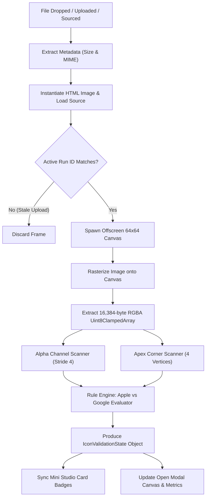
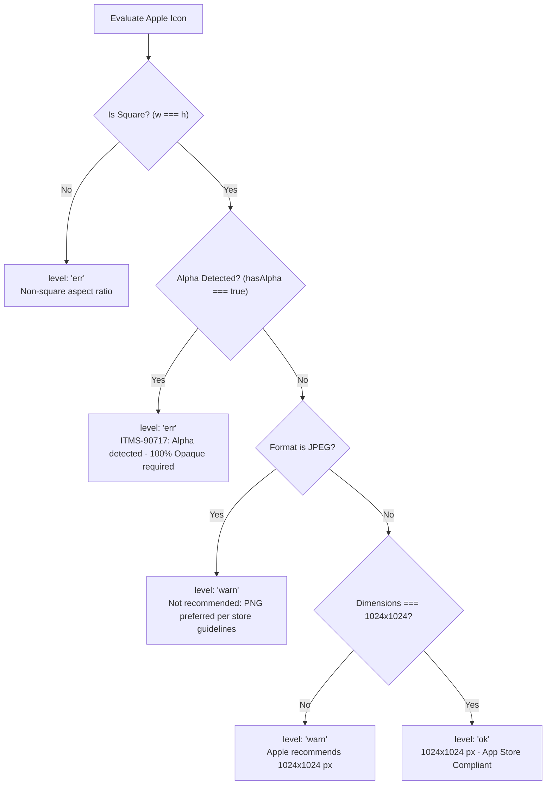
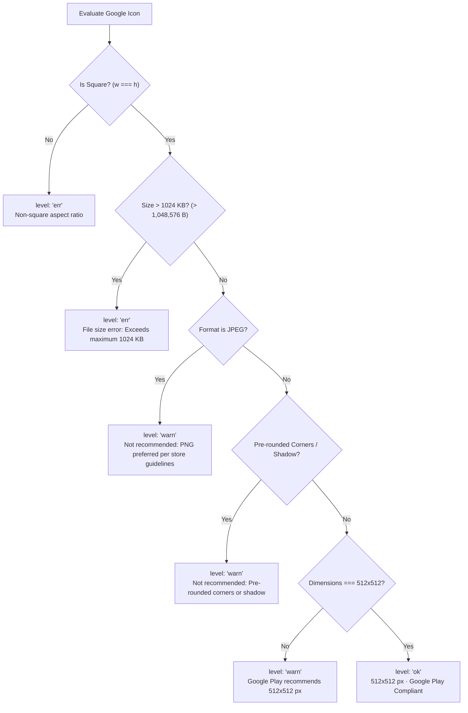

# Software Requirements Specification (SRS)
## App Icon Inspector & Store Compliance Engine

- **Project:** Store Preview Studio
- **Subsystem:** App Icon Inspector (Cross-Platform Store Asset Compliance Engine)
- **Target Modules:**
  - Mini Studio (Marketing Showcase): `docs/src/marketing/js/mini-studio.js`, `docs/src/marketing/css/icon-modal.css`
  - Core Studio (Main Application): `src/js/modules/shots.js`, `index.html`
- **Specification Version:** 1.0.0
- **Status:** Implemented & Verified
- **Verification Coverage:** 310/310 Automated Tests (100% Pass, Suite 13 Regression Guard)

---

### 1. Architectural Principles

#### Principle 0: Zero-Backend Client-Side Pixel Auditing
The icon compliance engine executes 100% within the user's browser runtime. It utilizes offscreen HTML5 `<canvas>` raster analysis to inspect image binary buffers without transmitting user assets to remote servers. This guarantees:
1. Zero network latency for real-time validation.
2. Complete data privacy and zero leak risk for unreleased intellectual property.
3. Offline operation under air-gapped development workflows.

#### Principle 1: Store Parity & Hard Rejection Prevention
The engine models the exact ingestion criteria enforced by Apple App Store Connect and Google Play Console. Its primary function is intercepting mechanical formatting errors before upload, specifically guarding against:
- Apple ITMS-90717 hard rejection (unwanted alpha channel transparency).
- Google Play Console 1024 KB maximum upload barrier.
- Non-square aspect ratio distortion on both platforms.
- Pre-cut corner rounding that clashes with native platform continuous squircles.

#### Principle 2: Tri-State Evaluation Model
Asset status is classified into three explicit categorical levels:
- **`ok` (Compliant):** Asset satisfies all platform criteria. Status badges render in emerald green (`#34d399` / `#059669`).
- **`warn` (Sub-Optimal / Non-Critical):** Asset will not be rejected by upload gateways, but diverges from recommended guidelines (e.g. 512x512 on Apple, JPEG format, or pre-rounded corners on Google Play). Status badges render in amber (`#fbbf24` / `#d97706`).
- **`err` (Submission Rejection Risk):** Asset violates strict platform ingestion schemas and will be rejected upon submission (e.g. non-square aspect ratio, alpha channel on iOS, or file size > 1024 KB on Android). Status badges render in ruby red (`#f87171` / `#dc2626`).

#### Principle 3: Presets Immutability & Ephemeral Safety
Built-in preset icons (`PulseFit`, `NomadTable`, `VaultPay`, `Zenith`) are certified, compliant assets.
- Built-in presets bypass heavy raster canvas computation, loading instantaneous `ok` validation state.
- Custom uploaded icons activate the full asynchronous canvas scanning pipeline.
- Custom uploads do not contaminate built-in preset definitions.

#### Principle 4: Asynchronous Race-Condition Immunity
Asset analysis relies on asynchronous image loading (`Image.onload`). To prevent stale validation states caused by rapid consecutive file uploads:
- Every validation dispatch generates a monotonically increasing transaction token (`runId`).
- Resolution handlers verify `_iconValidationRunIds[targetStore] === runId` before applying results to memory or DOM.
- Obsolete pipeline outputs are silently discarded.

#### Principle 5: Store Review Editorial Separation
The engine explicitly separates mechanical conformance (syntax/format checks) from human editorial review. The UI prominently displays a Store Review Disclaimer stating that passing mechanical checks does not guarantee store approval by Apple or Google review teams.

---

### 2. Store Compliance Specifications Matrix

| Specification Field | Apple App Store Connect | Google Play Console | SPS Engine Classification |
| :--- | :--- | :--- | :--- |
| **Standard Dimensions** | 1024 × 1024 px | 512 × 512 px | `ok` if exact match; `warn` if valid square with alternative resolution |
| **Aspect Ratio** | 1:1 Square | 1:1 Square | `ok` if 1:1; `err` if non-square (`w !== h`) |
| **Alpha / Transparency** | 100% Opaque (No alpha) | Alpha allowed for badge shapes | `err` on Apple if `hasAlpha === true`; `ok` on Google Play |
| **Rejection Code** | ITMS-90717: Alpha detected | Hard console upload reject | Direct error mapping in UI |
| **File Format** | PNG (sRGB or Display P3) | 32-bit PNG (sRGB) | `ok` for PNG; `warn` for JPEG |
| **Max File Size** | No hard limit published | Max 1024 KB (1,048,576 B) | `err` on Google Play if `sizeBytes > 1048576`; `ok` otherwise |
| **Corner Radius / Shadow** | Square (Masked by iOS) | Full bleed square (Masked by Android) | `warn` on Google Play if corner alpha `< 200` |
| **Color Space** | sRGB or Display P3 | sRGB | Inspected via PNG metadata / browser rendering |

---

### 3. Inspection Engine Architecture & Pixel Analysis Algorithms



#### 3.1 Metadata Extraction
Metadata is extracted from File objects or Base64 data URLs:
- **Byte Size Calculation:**
  ```javascript
  if (src.indexOf('data:') === 0) {
    var comma = src.indexOf(',');
    var b64 = src.slice(comma + 1);
    var pad = b64.endsWith('==') ? 2 : (b64.endsWith('=') ? 1 : 0);
    meta.size = Math.round((b64.length * 3) / 4 - pad);
  }
  ```
- **MIME Type Detection:** Parsed via `src.substring(5, semi)` from data URI or `File.type`.

#### 3.2 Offscreen Downsampling
To achieve sub-millisecond execution without blocking UI rendering on multi-megabyte source images:
1. An offscreen `<canvas>` of fixed dimensions `64 × 64` px is created.
2. The image is drawn via `ctx.drawImage(img, 0, 0, 64, 64)`.
3. Pixel buffer is acquired via `ctx.getImageData(0, 0, 64, 64).data`, returning exactly `64 × 64 × 4 = 16,384` bytes.

#### 3.3 Alpha Channel Audit Algorithm
Apple App Store Connect rejects any icon with transparent or semi-transparent pixels under rule ITMS-90717:
- The buffer is traversed with stride 4 at indices `i = 3, 7, 11, ..., 16383`.
- **Threshold Rule:** `data[i] < 250` flags `hasAlpha = true`.
- *Threshold Rationale:* A threshold of 250 (out of 255) prevents false rejections caused by canvas sub-pixel anti-aliasing while detecting genuine transparency, semi-transparent drop shadows, and anti-aliased cutouts.

#### 3.4 Pre-Rounded Corners & Drop Shadow Detection Algorithm
Google Play Console guidelines specify: *"Do not submit artwork with rounded corners or drop shadows. Google Play dynamically applies corner radius (20%) and drop shadow upon upload."*
- The inspector samples the four outermost apex corner pixels of the 64x64 grid:
  1. Top-Left: `(0, 0)` -> Byte index `(0 * 64 + 0) * 4 + 3 = 3`
  2. Top-Right: `(0, 63)` -> Byte index `(0 * 64 + 63) * 4 + 3 = 255`
  3. Bottom-Left: `(63, 0)` -> Byte index `(63 * 64 + 0) * 4 + 3 = 16131`
  4. Bottom-Right: `(63, 63)` -> Byte index `(63 * 64 + 63) * 4 + 3 = 16383`
- **Threshold Rule:** If `data[cornerIndex] < 200` on any corner vertex, `hasPreRoundedCorners = true`.
- *Threshold Rationale:* Full-bleed square artwork maintains solid background pixels (`alpha >= 250`) at the extreme corners. Pre-cut squircles or rounded corners leave transparent background corners (`alpha = 0` or semi-transparent anti-aliasing `< 200`).

---

### 4. Validation Rule Hierarchy & Decision State Machine

The rule engine prioritizes fatal submission errors over informational warnings.

#### 4.1 Apple App Store Validation Pipeline



1. **Priority 1 (Aspect Ratio Error):** If `w !== h`, return `level: 'err'`.
   - Message: `Non-square ([W]×[H] px) · 1:1 square required`
2. **Priority 2 (Alpha Rejection Error):** If `hasAlpha === true`, return `level: 'err'`.
   - Message: `ITMS-90717: Alpha detected · 100% Opaque required`
   - Guidance: `ITMS-90717 Error: Xcode and App Store Connect reject icons with alpha channels. Flatten background layers and export as PNG without transparency.`
3. **Priority 3 (Format Warning):** If `isJpeg === true`, return `level: 'warn'`.
   - Message: `Not recommended: PNG preferred per store guidelines`
4. **Priority 4 (Dimension Warning):** If `w !== 1024`, return `level: 'warn'`.
   - Message: `[W]×[H] px · Apple recommends 1024×1024 px`
5. **Priority 5 (Compliant):** If all criteria satisfied, return `level: 'ok'`.
   - Message: `1024×1024 px · App Store Compliant`

#### 4.2 Google Play Store Validation Pipeline



1. **Priority 1 (Aspect Ratio Error):** If `w !== h`, return `level: 'err'`.
   - Message: `Non-square ([W]×[H] px) · 1:1 square required`
2. **Priority 2 (File Size Error):** If `sizeBytes > 1024 * 1024` (1,048,576 bytes), return `level: 'err'`.
   - Message: `File size error: [KB] KB · Exceeds maximum 1024 KB`
   - Guidance: `Google Play Console strictly enforces a maximum file size of 1024 KB (1,048,576 bytes). Please compress or optimize the image before submitting.`
3. **Priority 3 (Format Warning):** If `isJpeg === true`, return `level: 'warn'`.
   - Message: `Not recommended: PNG preferred per store guidelines`
4. **Priority 4 (Artwork Mask Warning):** If `hasPreRoundedCorners === true`, return `level: 'warn'`.
   - Message: `Not recommended: Pre-rounded corners or shadow`
   - Guidance: `Pre-rounded corners or drop shadows are not recommended: Google Play dynamically applies a 20% corner radius mask and drop shadow on store listings. Export a full-bleed square image.`
5. **Priority 5 (Dimension Warning):** If `w !== 512`, return `level: 'warn'`.
   - Message: `[W]×[H] px · Google Play recommends 512×512 px`
6. **Priority 6 (Compliant):** If all criteria satisfied, return `level: 'ok'`.
   - Message: `512×512 px · Google Play Compliant ([KB] KB)`

---

### 5. Inspector Modal UI/UX Specifications

#### 5.1 Modal Frame & Layout Geometry
- **Backdrop Container (`.icon-modal-backdrop`):** Fixed position spanning entire viewport (`inset: 0`), `background: rgba(15, 23, 42, 0.7)` with `backdrop-filter: blur(12px)`. Z-index: `9999`. Smooth opacity transition (0.22s ease).
- **Dialog Canvas (`.icon-modal-canvas`):** Responsive centered box: `width: 82vw`, `max-width: 1060px`, `height: 82vh`, `max-height: 760px`. Border radius `18px`. Dark theme background `#0a0f1d`, light theme `#ffffff`.
- **Scroll Lock:** When modal is opened, `document.body.style.overflow = 'hidden'` and `document.documentElement.style.overflow = 'hidden'` are activated; restored to `''` on close.

#### 5.2 Header Region
- Title dynamically reflects store context: `Apple App Icon Inspector` or `Google Play Icon Inspector`.
- Header hints show drag affordance (`Drag & drop image`) and keyboard shortcut (`ESC to close`).
- Close button (`.icon-modal-close-btn`): 32x32 px circular button with hover scale animation.

#### 5.3 Left Viewport (Interactive Visualizer)
- Background styling incorporates a multi-layer radial gradient and checkerboard pattern (`16px 16px`) to clearly expose transparent alpha regions.
- Image element (`.icon-modal-img`) uses `object-fit: contain` within flex container to guarantee no aspect distortion during inspection.
- Drop Zone: Full left viewport acts as an active drop target (`dragover`, `dragleave`, `drop`).

#### 5.4 Right Info Panel & Metrics Grid
Panel width: `340px` fixed, containing:
1. **Spec Target Row:** Shows store pill badge (`Apple` in blue `#3b82f6` or `Google` in emerald `#10b981`) alongside standard target label (`Standard: 1024×1024 px (1:1)` or `Standard: 512×512 px (≤1024 KB)`).
2. **2x2 Metrics Grid:**
   - *Resolution Tile:* `[W] × [H] px`. CSS state: `.ok` if matches platform target, `.warn` otherwise.
   - *Aspect Ratio Tile:* `1:1 Square` or `[ratio]:1`. CSS state: `.ok` if 1:1, `.err` otherwise.
   - *File Size Tile:* `[N] KB` or `Optimized`. CSS state: `.err` if Google Play > 1024 KB, `.ok` otherwise.
   - *Format / Alpha Tile:* `PNG · Opaque` (`.ok`), `PNG · Alpha` (`.err` on Apple), or `JPEG` (`.warn`).
3. **Status Card:**
   - Status badge header (`.icon-modal-badge.ok`, `.warn`, `.err`).
   - Detailed warning/error box (`.icon-modal-warn-msg`) with red or amber left border (`3px solid`).
4. **Action Area:** Primary button `Upload New Icon` triggering hidden file input.
5. **Store Review Disclaimer:** Static notice emphasizing that mechanical compliance does not replace platform editorial review.

#### 5.5 Responsive Breakpoints
- **Desktop (Viewport > 768px):** Side-by-side two-column layout (`.icon-modal-art` flex 1, `.icon-modal-info-panel` 340px).
- **Tablet / Mobile (Viewport <= 768px):** Single-column stacked vertical layout. Art viewport fixed to `height: 260px`, `max-height: 38vh`. Info panel takes remaining vertical height with internal scrolling.
- **Small Mobile (Viewport <= 480px):** Art viewport reduces to `height: 210px`, `max-height: 32vh`. Drag hint hidden.

---

### 6. Functional Requirements

#### FR-II-01: Asset Metadata & Dimension Detection
- **System Behavior:** Upon receiving an icon (URL or file), the system shall synchronously extract byte size and MIME type, then asynchronously instantiate an `Image` object to determine `naturalWidth` and `naturalHeight`.
- **Verification:** Unit tests confirm accurate dimension calculation for standard (1024x1024, 512x512), high-resolution (2252x2252), and non-square (1200x800) assets.

#### FR-II-02: Alpha Transparency Ingestion Audit (Apple ITMS-90717 Guard)
- **System Behavior:** When evaluating an asset under Apple store mode, the system shall scan the RGBA buffer. If any pixel exhibits alpha `< 250`, the system shall immediately assign `level: 'err'` with badge `ITMS-90717: Alpha detected · 100% Opaque required`.
- **Verification:** Automated tests verify that `evaluateAppIconValidation(1024, 1024, true, 'apple')` returns status `'err'`.

#### FR-II-03: Google Play File Size Quota Guard
- **System Behavior:** When evaluating an asset under Google Play mode, if the estimated or actual file size exceeds `1,048,576` bytes (1024 KB), the system shall assign `level: 'err'` with badge `File size error: [N] KB · Exceeds maximum 1024 KB`.
- **Verification:** Code audit of `MAX_GOOGLE_ICON_BYTES = 1024 * 1024` threshold check in `mini-studio.js` and `shots.js`.

#### FR-II-04: Corner Radius & Pre-Mask Detection
- **System Behavior:** In Google Play mode, the system shall sample corner pixels `[3, 255, 16131, 16383]`. If any pixel alpha is `< 200`, the system shall flag `level: 'warn'` with warning `Not recommended: Pre-rounded corners or shadow`.
- **Verification:** Validated against official Google Play Developer specification regarding automated 20% squircle mask and shadow.

#### FR-II-05: Dynamic Card Status Badge Synchronization
- **System Behavior:** Mini Studio icon slots (`#msIconBadgeApple`, `#msIconBadgeGoogle`) shall dynamically display status badges only when an anomaly (`warn` or `err`) exists. If `level === 'ok'`, the card badge shall remain hidden (`display: none`) to preserve clean UI aesthetics.
- **Verification:** `applyIconCardBadge()` hides element when `state.level === 'ok'`.

#### FR-II-06: Inspector Modal Invocation & Lifecycle
- **System Behavior:** Clicking an icon card with an assigned icon opens the inspector modal. If the slot is empty or set to placeholder, clicking triggers the operating system file picker directly. Pressing `Escape` or clicking the backdrop outside the canvas dismisses the modal.
- **Verification:** Verified in `mini-studio.js` lines 1284-1291 and 1421-1475.

#### FR-II-07: In-Modal Asset Replacement & Re-Validation
- **System Behavior:** The inspector modal provides both a drag-and-drop viewport and a file upload button. Replacing an asset inside the modal immediately invokes the draft modification flow, updates storage, and re-renders modal metrics without closing the dialog.
- **Verification:** Verified via `readImages()` callback triggering `handleIconUpload()` followed by immediate `openIconModal()`.

#### FR-II-08: Cross-Store Re-Evaluation on Platform Switch
- **System Behavior:** Switching store mode (e.g. Apple to Google Play) must immediately re-validate active icons against the new store's criteria. An asset that is compliant under Apple (1024x1024) must trigger a dimension notice (`warn`) under Google Play (512x512 required), and vice-versa.
- **Verification:** Suite 13 regression tests verify four-step cross-switching sequence (Apple -> Google -> Resize -> Apple).

---

### 7. Data Contracts & Type Definitions

```typescript
export type StoreType = 'apple' | 'google';

export type ValidationLevel = 'ok' | 'warn' | 'err';

export interface IconMetadata {
  size: number;        // File size in bytes
  type: string;        // MIME type (e.g. 'image/png')
  name?: string;       // Original filename if uploaded
}

export interface IconValidationState {
  src: string;
  width: number;
  height: number;
  isSquare: boolean;
  sizeBytes: number;
  mimeType: string;
  isJpeg: boolean;
  hasAlpha: boolean;
  hasPreRoundedCorners: boolean;
  level: ValidationLevel;
  badgeText: string;
  modalBadgeText: string;
  detailsHtml: string;
  isCustom: boolean;
}
```

---

### 8. Traceability & Verification Matrix

| Requirement ID | Specification Description | Source Code Location | Automated Test Suite |
| :--- | :--- | :--- | :--- |
| **FR-II-01** | Metadata & Dimension Extraction | `mini-studio.js` (L398-413, L556-569)<br>`shots.js` (L41-49) | Suite 13 (Assertions 1, 2) |
| **FR-II-02** | Alpha Detection (Apple ITMS-90717) | `mini-studio.js` (L578-580, L613-618)<br>`shots.js` (L59-62, L111-115) | Suite 13 (Assertion 1.2) |
| **FR-II-03** | Google Play File Size Quota (1024 KB) | `mini-studio.js` (L638, L644-650)<br>`shots.js` (L157-163) | Code Audit & Suite 13 |
| **FR-II-04** | Google Play Corner Mask Audit | `mini-studio.js` (L581-587, L656-660)<br>`shots.js` (L68-74, L177-180) | Code Audit & Suite 13 |
| **FR-II-05** | Card Badge Synchronization | `mini-studio.js` (L420-432, L366-374) | Browser DOM Verification |
| **FR-II-06** | Inspector Modal Lifecycle & ESC Lock | `mini-studio.js` (L1326-1475)<br>`icon-modal.css` (L1-45) | DOM Event Testing |
| **FR-II-07** | In-Modal Asset Replacement | `mini-studio.js` (L1435-1469) | DOM Event Testing |
| **FR-II-08** | Cross-Store Switching Re-evaluation | `mini-studio.js` (L386-393)<br>`shots.js` (L33-36) | Suite 13 (Assertions 3A, 3B, 3C, 3D) |
