# Software Requirements Specification (SRS)
## Mini Studio Single-Draft Architecture, Validation & Store DOM Engine

- **Project:** Store Preview Studio
- **Module:** Mini Studio (Interactive Landing Page Showcase)
- **Target Sources:**
  - Logic Engine: `docs/src/marketing/js/mini-studio.js`
  - Markup & DOM: `docs/src/marketing/components/mini-studio.html`, `docs/src/marketing/components/mini-studio-form.html`
  - Styling: `docs/src/marketing/css/mini-studio.css`, `docs/src/marketing/css/mini-studio-form.css`, `docs/src/marketing/css/mini-studio-stage.css`
  - DOM Specifications: `docs/srs/dom-spec/APPLE_APP_STORE_IPHONE_DOM_SPEC.md`, `docs/srs/dom-spec/GOOGLE_PLAY_ANDROID_PHONE_DOM_SPEC.md`
- **Specification Version:** 1.2.0
- **Status:** Implemented & Verified
- **Verification Coverage:** 310/310 Automated Tests (100% Pass)

---

### 1. Architectural Principles

#### Principle 0: Single Active Draft Axiom
The system maintains strictly at most one persistent user draft session stored under the key `sps_mini_user_draft`. The application does not support multi-draft workspaces or concurrent draft instances. All operations either act upon this single draft or on read-only built-in presets.

#### Principle 1: Offline-First Dual Storage
Draft persistence operates completely client-side without network dependencies:
1. **Synchronous Cache (`localStorage`):** Stores metadata and truncated icon payloads for instantaneous page boot.
2. **High-Capacity Engine (`IndexedDB`):** Database `sps_marketing_db`, object store `marketing_drafts`. Stores full uncompressed base64 data URLs for high-resolution App Store icons (1024x1024) and Google Play icons (512x512).

#### Principle 2: Safe Ephemeral Sandboxing on Presets
Built-in presets (`PulseFit`, `NomadTable`, `VaultPay`, `Zenith`) are immutable showcases. When a draft exists and the user interacts with a preset:
- User edits are treated as temporary in-memory previews.
- Edits must never corrupt or overwrite the stored user draft.
- Edits must never persist to browser storage.
- Navigating away from the preset or clicking return discards all temporary modifications.

#### Principle 3: Explicit Funnel & Lock Affordance
- Built-in presets allow free 2x Retina mockup exports.
- Custom draft exports are gated features requiring the Plus Edition.
- UI elements must visually reflect lock status (via `.is-locked` and `.mi-pill-lock`) prior to user interaction to prevent unexpected blocking.

#### Principle 4: Store DOM Authenticity & Content Ordering
Device mockups must strictly replicate the real DOM tree and section hierarchy of the Apple App Store and Google Play Store client applications. In particular:
- On Apple App Store, the Preview Screenshot Carousel must sit directly after the Metrics Shelf and before Description.
- On Google Play Store, the Install CTA and Screenshots must sit directly after the Metrics Shelf and before About this app.
- Reviews and Ratings must render authentic user feedback cards, breakdown bars, and store-specific metadata badges.

---

### 2. State Machine Diagram

```mermaid
stateDiagram-v2
    [*] --> Uninitialized: Page Load (No Draft)
    [*] --> ViewingPresetWithDraft: Page Load (Draft in Storage)

    state Uninitialized {
        [*] --> ViewingPresetClean: Default Preset Loaded
        ViewingPresetClean --> DraftActive: User Edits Preset Form (Rule 1)
        ViewingPresetClean --> DraftActive: User Clicks + Your App (Rule 1)
    }

    state DraftActive {
        [*] --> EditingDraft: Draft Loaded
        EditingDraft --> EditingDraft: Input / Upload (Saves to Storage)
        EditingDraft --> Uninitialized: Click Reset [X] -> Confirm (Rule 0)
        EditingDraft --> ViewingPresetWithDraft: User Selects Preset Pill
    }

    state ViewingPresetWithDraft {
        [*] --> PresetCleanView: Preset Loaded
        PresetCleanView --> PresetEphemeralModified: User Edits Form / Uploads Icon (Rule 2)
        PresetEphemeralModified --> PresetCleanView: User Selects Different Preset (Discards Edit)
        PresetEphemeralModified --> EditingDraft: User Clicks Return / Draft Pill (Discards Edit)
        PresetCleanView --> EditingDraft: User Clicks Return / Draft Pill
        PresetCleanView --> ViewingPresetClean: Click Reset [X] on Draft Pill
    }
```

---

### 3. Functional Requirements

#### FR-01: Draft Initialization (Pre-Creation Phase)
**Pre-condition:** `hasUserDraft() === false` (no record in memory, `localStorage`, or `IndexedDB`).
- **Trigger A (Explicit Click):** User clicks the `+ Your App` pill (`#msPill-custom`).
  - System initializes `userDraft` from default template `CUSTOM`.
  - Sets `userDraft.isCustomized = true`.
  - Persists state via `saveDraftToStorage()`.
  - Sets `activeKey = 'custom'`.
  - Toggles pill class `.on` to `#msPill-custom`.
  - Focuses `#msName` input.
- **Trigger B (Direct Preset Mutation):** User modifies any field (`#msName`, `#msSub`, `#msShort`) or uploads an icon while viewing a preset.
  - System invokes `initDraftFromCurrentPreset()`.
  - Deep-clones active preset state `S` into `userDraft`.
  - Sets `userDraft.key = 'custom'` and `userDraft.isCustomized = true`.
  - Switches `activeKey = 'custom'`.
  - Deselects preset pill and selects `#msPill-custom` (`.on`).
  - Applies user input to newly initialized draft.
  - Saves to storage and updates custom pill UI.
  - Ensures `#msPresetBanner` remains hidden (`display: none`).

#### FR-02: Preset Ephemeral Preview (Post-Creation Phase)
**Pre-condition:** `hasUserDraft() === true` and `activeKey !== 'custom'`.
- **Navigation:** User clicks any preset pill.
  - Preset data is freshly loaded from immutable `PRESETS` array.
  - `isPresetModified` is reset to `false`.
  - `#msPresetBanner` is displayed (`display: inline-flex`).
  - Banner indicator dot (`.ms-preset-banner-dot`) renders in neutral blue (`#3b82f6`).
  - Banner text displays standard notice:
    - *English:* `Viewing preset: <strong id="msPresetBannerName">[Preset Name]</strong> · Your draft is saved safely.`
    - *Vietnamese:* `Đang xem template: <strong id="msPresetBannerName">[Preset Name]</strong> · Bản nháp của bạn đã được lưu an toàn.`
- **Ephemeral Input Handling:** User modifies form inputs or drops an icon on the preset view.
  - System detects `activeKey !== 'custom' && hasUserDraft()`.
  - Sets `isPresetModified = true`.
  - Updates only in-memory preview state `S` and live mockups (`bindText`, `renderValidation`, `flash`).
  - **Does NOT** modify `userDraft`.
  - **Does NOT** call `saveDraftToStorage()`.
  - **Does NOT** alter pill active state.
  - Banner indicator dot switches to warning amber (`#f59e0b` in Dark mode, `#d97706` in Light mode).
  - Banner text dynamically updates to warning copy:
    - *English:* `<strong>Preview only: edits won't be saved</strong> · Your draft is saved safely.`
    - *Vietnamese:* `<strong>Đang xem thử: thay đổi sẽ không được lưu</strong> · Bản nháp của bạn đã được lưu an toàn.`
- **Discard Behavior:**
  - When user selects another preset or clicks `[Return to My App]`:
    - In-memory state `S` is reloaded from selected preset or `userDraft`.
    - Any ephemeral text or uploaded images are purged without confirmation.
    - `isPresetModified` resets to `false`.

#### FR-03: Draft Editing & Persistence
**Pre-condition:** `activeKey === 'custom'`.
- All text input events update both `S[key]` and `userDraft[key]`.
- Input clamping uses grapheme cluster analysis (`Intl.Segmenter`):
  - App Name: max 30 graphemes.
  - Subtitle: max 30 graphemes.
  - Short Description: max 80 graphemes.
- Calls `saveDraftToStorage()` synchronously to `localStorage` and asynchronously to `IndexedDB`.
- Updates `#msPill-custom` content:
  - Displays draft app name (fallback: `Your App`).
  - Displays uploaded or preset icon thumbnail.
  - Displays `<small>Draft</small>` badge.
  - Attaches reset button `[X]`.
- `#msPresetBanner` is strictly hidden (`display: none`).

#### FR-04: Draft Deletion & Reset
- User clicks reset button `[X]` (`.ms-pill-reset-btn`) on `#msPill-custom`.
- Modal `#msConfirmModal` is displayed requesting confirmation.
- On confirmation (`resetUserDraft()`):
  - `userDraft` set to `null`.
  - Removes `localStorage.removeItem('sps_mini_user_draft')`.
  - Deletes IndexedDB record via `idbDeleteMini('sps_mini_user_draft')`.
  - Resets custom icon metadata and flags.
  - If `activeKey === 'custom'`, clears form inputs and restores blank `CUSTOM` mockup.
  - Reverts custom pill to `+ Your App` (removes `.has-draft`).
  - Hides `#msPresetBanner`.
  - Resets export mockup button state.
  - System transitions to Uninitialized state (`FR-01`).

#### FR-05: Dynamic Export Mockup Button State
- Target Element: `#btnExportMockup4K` inside `#menuExport`.
- **State A - Preset Mode (`activeKey !== 'custom'`):**
  - Class: `.active-export`.
  - Badge: `<span class="mi-pill mi-pill-blue">2x PNG</span>` (no lock icon).
  - Tooltip: `Export current live device stage in 2x Retina HD`.
  - Interaction: Triggers `html2canvas` 2x rendering and file download.
- **State B - Draft Mode (`activeKey === 'custom'`):**
  - Class: `.is-locked` (removes `.active-export`).
  - Badge: `<span class="mi-pill mi-pill-blue">2x PNG</span><span class="mi-pill-lock" title="Plus Feature"><svg .../></span>`.
  - Tooltip: `Unlock Plus Edition to export mockups with your custom app branding`.
  - Interaction: Suppresses canvas generation; displays upsell toast modal for Plus Edition.

#### FR-06: 2X Export Cleanliness & Animation Sanitization
To prevent html2canvas from capturing transient CSS animation keyframes (such as yellow background highlights on edited fields):
1. **Pre-capture DOM Sanitization:**
   - Calls `setFocus(null)` to eliminate focus rings.
   - Adds `.is-exporting` to `#msStage`.
   - Removes `.ms-focus`, `.ms-hl`, `.ms-hl-target` from `#msStage`.
2. **Clone Mutation Hook (`onclone`):**
   - Strips `.ms-hl` and `.ms-hl-target` from all cloned elements.
   - Forcibly overrides inline styles: `backgroundColor = 'transparent'`, `outline = 'none'`, `animation = 'none'`.
3. **CSS Hard-rule (`mini-studio-stage.css`):**
   - `.ms-stage.is-exporting .ms-hl, .ms-stage.is-exporting [data-f]` forced to `background: transparent !important; animation: none !important;`.
4. **Self-cleaning Timers:**
   - `flash(field)` sets `setTimeout(..., 1150)` to remove `.ms-hl` immediately upon animation completion.

#### FR-07: Text Field Validation & Real-Time Clamping Engine
The Mini Studio form contains strictly three editable text fields. Each field operates under an automated validation, counting, and decoupled clamping engine:

##### 1. Field Allocation & Limits

| Element ID | Key | Platform Scope | Max Limit | Store Guideline Reference |
| :--- | :--- | :--- | :--- | :--- |
| `#msName` | `name` | Apple & Google | 30 graphemes | App Store Connect & Google Play Console app name quota |
| `#msSub` | `sub` | Apple Only (`data-only="apple"`) | 30 graphemes | Apple App Store subtitle quota |
| `#msShort` | `short` | Google Only (`data-only="google"`) | 80 graphemes | Google Play Console short description quota |

##### 2. Grapheme Cluster Counting Algorithm
To prevent counting inaccuracies caused by unicode multi-byte characters, accented Vietnamese tones (e.g. `ở`, `ề`), and composite emojis:
- The system evaluates graphemes using `Intl.Segmenter`:
  ```javascript
  var seg = (typeof Intl !== 'undefined' && Intl.Segmenter) ? new Intl.Segmenter('en', { granularity: 'grapheme' }) : null;
  function graphemes(t) { return seg ? Array.from(seg.segment(t)).length : Array.from(t).length; }
  ```
- Standard `String.length` is strictly prohibited for field validation.

##### 3. Four-Tier Counter States (`renderField`)
The counter element (`#ms...Count`) displays `[n] / [max]` and transitions across four visual states:
- **`.empty` (`n === 0`):** Muted indicator color (`#64748b`).
- **`.has` (`n > 0` and `n < max - 4`):** Active input color (`#94a3b8`).
- **`.near` (`n >= max - 4` and `n <= max`):** Amber warning (`#f59e0b` / `#d97706`), signaling approaching character ceiling.
- **`.over` (`n > max`):** Red error state (`#ef4444` / `#dc2626`), signaling store rejection risk.

##### 4. Dynamic Progress Bar
The inline progress bar container (`.ms-bar`) hosts an indicator (`#ms...Bar`):
- `width = Math.min(100, (n / max) * 100) + '%'`.
- Toggles `.near` class when approaching limit.
- Toggles `.over` class when `n > max`.

##### 5. Decoupled Clamping Engine (Input vs. Mockup vs. Storage)
- **Form Input UX:** When `n > max`, the input field does not lock typing. Users retain full freedom to type, paste, and trim copy. The input receives `.ms-input.over`.
- **Live Device Mockup Guard:** Device mockups display store-ready presentation only. Text bound to mockups via `bindText()` is clamped strictly via `clampGraphemes(val, limit)`. If clamped, the mockup element receives `.ms-trunc` and an explanatory tooltip (`title="Clamped to 30 characters"` or `title="Clamped to 80 characters"`).
- **Draft Storage Guard:** When persisting to `userDraft`, text is permanently sanitized via `clampGraphemes(el.value, maxLimit)` to guarantee stored draft JSON complies with store limits.

##### 6. Platform Filter Responsiveness
- **Apple Mode:** `#msSub` visible, `#msShort` hidden (`display: none`).
- **Google Mode:** `#msShort` visible, `#msSub` hidden (`display: none`).
- **Dual Mode:** Both `#msSub` and `#msShort` visible with respective platform pill badges (`APPLE`, `GOOGLE`).

##### 7. Version & Release Date Store Isolation Specification
- **Store-Specific Metadata Rule:** Google Play automatically derives app versions and release dates from uploaded release bundles (AAB/APK) and production rollout telemetry. Neither field exists in the public Google Play storefront DOM (`<span data-b="ver" hidden></span>` and `<span data-b="rdate" hidden></span>`).
- **Form Behavior:** The Version & Release Date container row (`.form-row-2col`) possesses `data-only="apple"` and is automatically hidden (`display: none !important`) when the active store is Google Play. On Apple App Store, both fields are displayed side-by-side to feed into Apple's public "What's New" storefront card.

##### 8. Full Description Display & Focus Linking Specification
- **Storefront Display Divergence:**
  - *Apple App Store:* Full Description renders directly on the main storefront listing below Screenshots, truncated to the first 3 lines with an inline "more" expansion button.
  - *Google Play Store:* The primary storefront listing DOM only renders the Short Description (max 80 graphemes). Full Description is maintained in a collapsed/hidden state (`<span data-b="desc" hidden></span>`). In the native Google Play app, tapping "About this app" navigates to an independent sub-activity screen rather than expanding inline.
- **Focus Routing & Visual Highlight:**
  - An explanatory info tooltip popover (`#descInfoPop`) is attached to the Full Description label via `#descInfoBtn`.
  - When the user focuses the Full Description field (`#f-desc`), Preview Studio programmatically scrolls the active device view and applies `.hl-target` with `border-radius: 50% !important; outline: 2px solid #f59e0b; outline-offset: 2px;` to the circular arrow button (`.g-desc-arrow`) on Google Play, and to `.a-txt.pre[data-b="desc"]` on Apple App Store.

##### 9. App Privacy & Data Safety Compliance Questionnaire Architecture
- **Non-Editable Store Questionnaire Principle:** Neither Apple nor Google accepts free-form text for privacy declarations. Both stores mandate structured technical compliance questionnaires inside App Store Connect (Nutrition Labels) and Google Play Console (Data Safety section).
- **Compact Form Presentation:** Free-text inputs are eliminated from the active form layout to prevent user confusion and vertical clutter. The feature is represented as an interactive Compact Info Banner (`#privacyMockBanner`) with store badges (`APPLE`, `GOOGLE`) and an explanatory tooltip (`#privacyInfoPop`).
- **Inspection Affordance:** Clicking or pressing Space/Enter on `#privacyMockBanner` triggers `setFieldFocus('privacy', true)`, which smoothly scrolls the device viewport and outlines the corresponding privacy card (`[data-google-safety]` on Google Play, `[data-apple-priv-wrap]` on Apple App Store) with an amber border. Hidden form inputs (`#f-priv-linked`, `#f-priv-notlinked`, `#f-priv-google`) are retained in memory for backward compatibility with export and preset engines.

---

### 4. Device Phone Mockup DOM Specifications

The device mockups in Mini Studio render high-fidelity, native-faithful storefront layouts for iPhone (Apple App Store) and Android (Google Play Store).

```mermaid
flowchart TD
    subgraph Apple_iPhone_DOM["Apple App Store (iPhone)"]
        A1["1. Navigation Bar (.ms-a-nav)"] --> A2["2. App Header (.ms-a-head)"]
        A2 --> A3["3. Metrics Shelf (.ms-a-met)"]
        A3 --> A4["4. Preview Gallery (.ms-sec > .ms-gal)"]
        A4 --> A4b["Device Support Badge (.ms-a-platforms)"]
        A4b --> A5["5. Promo & Description (.ms-promo + .ms-desc)"]
        A5 --> A6["6. Ratings & Reviews (.ms-a-ratings-row + .ms-a-reviews-list)"]
        A6 --> A7["7. What's New (.ms-wn-row)"]
        A7 --> A8["8. App Privacy (.ms-pg > .ms-pc)"]
        A8 --> A9["9. Information Table (.ms-inf)"]
    end

    subgraph Google_Android_DOM["Google Play (Android)"]
        G1["1. Top Navigation Bar (.ms-g-top)"] --> G2["2. App Header (.ms-g-head)"]
        G2 --> G3["3. Metrics Shelf (.ms-g-met)"]
        G3 --> G4["4. Install Button (.ms-inst)"]
        G4 --> G5["5. Screenshot Gallery (.ms-gal)"]
        G5 --> G6["6. About this app (.ms-g-blk > .ms-g-sd + .ms-chips)"]
        G6 --> G7["7. Data safety (.ms-g-blk > .ms-safe)"]
        G7 --> G8["8. Ratings and reviews (.ms-g-rating-breakdown + .ms-g-reviews-list)"]
        G8 --> G9["9. App support (.ms-g-blk > .ms-g-sup)"]
    end
```



#### 4.1 Apple App Store iPhone Mockup DOM Architecture
- **Root Element:** `#msDevApple` > `#msPhoneApple.ms-phone.a` > `.ms-screen` > `.ms-body`.
- **Top Hardware Emulation:** Dynamic Island (`.ms-island`) and Status Bar (`.ms-sb` with clock `.ms-clock-apple` "9:41").
- **Section Order & DOM Contract:**
  1. **Navigation Bar (`.ms-a-nav`):**
     - Back navigation icon button: `.ms-a-nav-btn.ms-a-nav-back`.
     - Center scroll icon: `img.ms-a-nav-ico[data-img="icon"]`.
     - Right utility actions: `.ms-a-nav-share`, `.ms-a-nav-get`.
  2. **App Header (`.ms-a-head`):**
     - Large Squircle Icon: `img.ms-a-ico[data-img="icon"][data-f="icon"]`.
     - App Metadata Container: `.ms-a-info`
       - Name: `.ms-a-name[data-bind="name"][data-f="name"]`.
       - Subtitle: `.ms-a-sub[data-bind="sub"][data-f="sub"]`.
       - Primary CTA: `.ms-a-act` > button `.ms-get` ("GET").
  3. **Metrics Shelf (`.ms-a-met`):**
     - Flex horizontal band featuring 5 standardized store metrics:
       - RATINGS: `[data-bind="rating"]` star rating · `[data-bind="count"]` Ratings.
       - AGE: `[data-bind="age"]` Years Old.
       - CHART: #`[data-bind="rank"]` · `[data-bind="catApple"]`.
       - DEVELOPER: `[data-bind="dev"]` · Studio.
       - LANGUAGE: `EN` · +4 More.
  4. **Preview Gallery (`.ms-sec`):**
     - Title: `.ms-sec-h` ("Preview").
     - Horizontal Carousel: `.ms-gal[data-gal][data-f="shots"]`.
     - Device Support Badge: `.ms-a-platforms` with SVG icons for iPhone & iPad and copy `iPhone, iPad`.
     - *Mandatory Hierarchy Rule:* The Preview Gallery must immediately follow the Metrics Shelf. No other section may intervene.
  5. **Promotional Text & Description:**
     - Promo Callout: `.ms-promo[data-bind="promo"]` (hidden if empty).
     - Section Block: `.ms-sec` > `.ms-sec-h` ("Description") + `.ms-desc[data-bind="desc"]`.
  6. **Ratings & Reviews (`.ms-sec`):**
     - Header: `.ms-sec-h` ("Ratings & Reviews" + chevron).
     - Score Row: `.ms-a-ratings-row` (big score `[data-bind="rating"]`, 5 gold stars `#ff9500`, total count `[data-bind="count"]`).
     - User Reviews Carousel: `.ms-a-reviews-list` containing `.ms-a-rev-card` units (Title, Date, Star Rating, Author, Review Body).
  7. **What's New (`.ms-sec`):**
     - Header: `.ms-sec-h` ("What's New" + chevron).
     - Release Card: `.ms-wn-row` > `.ms-wn-text[data-bind="whatsNew"]`, version row `.ms-vm` (Version `[data-bind="ver"]`, date `[data-bind="rdate"]`).
     - *Mandatory Hierarchy Rule:* Must be located after Reviews and before App Privacy.
  8. **App Privacy (`.ms-sec`):**
     - Header: `.ms-sec-h` ("App Privacy" + chevron).
     - Narrative: `.ms-priv-txt` referencing developer `[data-bind="dev"]`.
     - Privacy Cards Grid: `.ms-pg` hosting `.ms-pc` cards ("Data Linked to You", "Data Not Linked to You").
  9. **Information Table (`.ms-sec`):**
     - Header: `.ms-sec-h` ("Information").
     - Two-column metadata grid: `.ms-inf` (Provider, Size, Category `[data-bind="catApple"]`, Compatibility, Languages, Age Rating `[data-bind="age"]`, In-App Purchases).
- **Bottom Navigation:** Tab bar component (`components/common/apple-tab-bar.html`) with Today, Games, Apps, Arcade, Search.

#### 4.2 Google Play Android Phone Mockup DOM Architecture
- **Root Element:** `#msDevGoogle` > `#msPhoneGoogle.ms-phone.g` > `.ms-screen` > `.ms-body`.
- **Top Hardware Emulation:** Camera hole punch (`.ms-hole`) and Status Bar (`.ms-sb` with clock `.ms-clock-google` "09:41").
- **Section Order & DOM Contract:**
  1. **Top Navigation Bar (`.ms-g-top`):**
     - Back arrow SVG icon.
     - Actions: `.ms-g-top-act` (Bookmark/Wishlist icon, 3-dots overflow icon).
  2. **App Header (`.ms-g-head`):**
     - Full-bleed Squircle Icon: `img.ms-g-ico[data-img="iconGoogle"][data-f="iconGoogle"]`.
     - Text Column:
       - App Name: `.ms-g-name[data-bind="name"][data-f="name"]`.
       - Developer: `.ms-g-dev[data-bind="dev"]`.
  3. **Metrics Shelf (`.ms-g-met`):**
     - 3 key chips in horizontal flex:
       - Rating Chip: `[data-bind="rating"]` star rating · `[data-bind="count"]` reviews.
       - Downloads Chip: `[data-bind="dl"]` Downloads.
       - Content Rating (ESRB): `.esrb[data-bind="esrb"]` · `[data-bind="esrbLabel"]`.
  4. **Primary CTA:**
     - Button: `button.ms-inst` ("Install") spanning full width.
  5. **Screenshot Gallery:**
     - Horizontal Carousel: `.ms-gal[data-gal][data-f="shots"]`.
  6. **About this app (`.ms-g-blk`):**
     - Header: `.ms-g-h` ("About this app" + right arrow).
     - Short Description: `.ms-g-sd[data-bind="short"][data-f="short"]`.
     - Taxonomy Chips: `.ms-chips` (Category `[data-bind="catGoogle"]`, Rank `#<span data-bind="rank"></span> Top Free`, secondary tags).
  7. **Data safety (`.ms-g-blk`):**
     - Header: `.ms-g-h` ("Data safety" + right arrow).
     - Policy intro: `.ms-safe-intro`.
     - Safety bullet rows: `.ms-safe`
       - Row 1: "No data shared with third parties".
       - Row 2: "Data is encrypted in transit".
       - Row 3: "You can request data deletion".
     - Details link: `.ms-safe-more` ("See details").
  8. **Ratings and reviews (`.ms-g-blk`):**
     - Header: `.ms-g-h` ("Ratings and reviews" + right arrow).
     - Verification notice: `.ms-safe-intro`.
     - Rating Breakdown Hero: `.ms-g-rating-breakdown`
       - Left Score Column: `[data-bind="rating"]`, star rating, review count `[data-bind="count"]`.
       - Right Bar Graph: 5 rating breakdown bars (`.ms-g-bar-track` & `.ms-g-bar-fill`).
     - User Reviews Carousel: `.ms-g-reviews-list` containing `.ms-g-rev-card` units (Avatar initial, author, date, review body, helpful counter, Yes/No feedback chips).
  9. **App support (`.ms-g-blk`):**
     - Header: `.ms-g-h` ("App support" + expand chevron).
     - Support details grid: `.ms-g-sup` (Website, Phone `[data-bind="phone"]`, Email `[data-bind="email"]`, Privacy policy, Developer registered address).
  10. **What's New (Release Notes) Display Rule:**
     - Pre-install storefront listing does not render What's New. The release notes only appear on devices when the app is already installed and an update is pending.
     - In Google Play Console, release notes are strictly required per release track (capped at 500 characters).
     - Preview Studio retains What's New for both stores, featuring a dedicated Tooltip Guide (`#whatsNewInfoBtn` & `#whatsNewInfoPop`).
- **Bottom Navigation:** Bottom bar (`.ms-gnav`) with Games, Apps, Search (active), Books.

---

### 5. Data Storage Contract

```json
{
  "key": "custom",
  "name": "PulseFit Pro",
  "sub": "Fitness & Calorie Tracker",
  "short": "Track workouts and monitor health metrics.",
  "desc": "App description goes here...",
  "whatsNew": "Release notes...",
  "ver": "1.0.0",
  "rdate": "Oct 26, 2026",
  "rating": "4.9",
  "count": "1.8K",
  "rank": "1",
  "dl": "50K+",
  "age": "4+",
  "iap": true,
  "icon": "data:image/png;base64,...",
  "iconApple": "data:image/png;base64,...",
  "iconGoogle": "data:image/png;base64,...",
  "shots": [
    "assets/showcase/pulsefit-1.png",
    "assets/showcase/pulsefit-2.png"
  ],
  "feature": "assets/showcase/pulsefit-feature.png",
  "promo": "",
  "reviews": [],
  "customUploadedIcons": {
    "apple": false,
    "google": false
  },
  "customUploadedMeta": {
    "apple": null,
    "google": null
  },
  "isCustomized": true
}
```

---

### 6. Traceability Matrix

| Requirement | Implementation Function | File Location | Test Suite |
| :--- | :--- | :--- | :--- |
| **FR-01** (Init Draft) | `initDraftFromCurrentPreset()`, `loadPreset('custom')` | `docs/src/marketing/js/mini-studio.js` | Suite 12 / Case D1 |
| **FR-02** (Ephemeral Preset) | Text input listeners, `handleIconUpload()`, `updatePresetBanner()` | `docs/src/marketing/js/mini-studio.js` | Suite 12 / Case D2 |
| **FR-03** (Draft Edit) | Text input listeners, `saveDraftToStorage()` | `docs/src/marketing/js/mini-studio.js` | Suite 11 / Storage |
| **FR-04** (Reset Draft) | `resetUserDraft()`, `showResetConfirmModal()` | `docs/src/marketing/js/mini-studio.js` | Suite 12 / Case D3 |
| **FR-05** (Lock State) | `updateExportMockupState()` | `docs/src/marketing/js/mini-studio.js` | Suite 13 / Store Switch |
| **FR-06** (Export Cleanliness) | `doExport()`, `flash()`, `.is-exporting` | `docs/src/marketing/js/mini-studio.js`, `mini-studio-stage.css` | Suite 10 / Canvas Export |
| **FR-07** (Field Validation & Clamp) | `renderField()`, `renderValidation()`, `clampGraphemes()` | `docs/src/marketing/js/mini-studio.js`, `mini-studio-form.html` | Suite 2 / Grapheme Counter |
| **DOM-Apple** (iPhone DOM Spec) | Apple Device Mockup Structure | `docs/src/marketing/components/mini-studio.html` | Suite 7 / Ribbon Viewport |
| **DOM-Google** (Android DOM Spec) | Google Device Mockup Structure | `docs/src/marketing/components/mini-studio.html` | Suite 13 / Store Switch |
